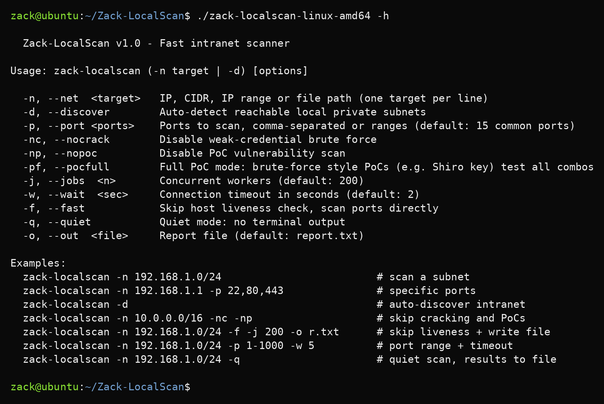
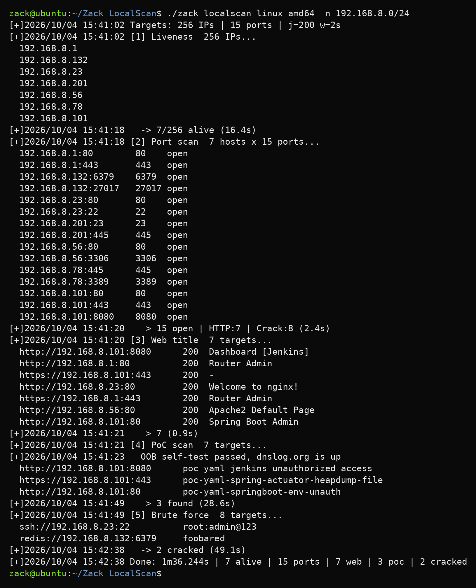
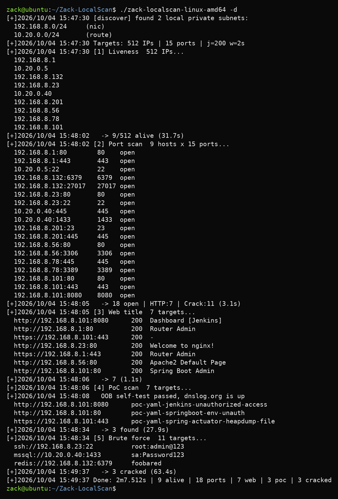

# Zack-LocalScan

[English](README.md) | **简体中文**

**Zack-LocalScan** 是一款 Go 语言编写的内网渗透扫描工具。一条命令自动完成**主机发现 → 端口扫描 → Web 标题提取 → PoC 漏洞验证 → 弱口令爆破**全流程，帮助安全团队在内网横向移动中快速锁定高价值目标。

> **免责声明**
> 本工具仅供授权的安全测试、红队演练及教学研究使用。使用者应确保已获得目标系统的书面
> 授权，并遵守所在国家/地区的法律法规。未经授权扫描或攻击他人系统可能构成违法犯罪行为。

## 构建

要求 Go 1.25+（更低版本的工具链会通过 `GOTOOLCHAIN=auto` 自动下载）。

```bash
go build -o zack-localscan .
```

交叉编译三个平台：

```bash
./build.sh          # linux/amd64、windows/amd64、darwin/arm64 -> build/
.\build.ps1         # PowerShell 版（-NoClean 保留已有产物）
```

## 命令行参考

```
用法: zack-localscan (-n 目标 | -d) [选项]

  -n, --net  <目标>    单个 IP、CIDR、IP 段或文件路径（每行一个目标）
  -d, --discover       自动探测本机可达的私有网段
  -p, --port <端口>    扫描端口，逗号分隔或范围（默认：15 个常用端口）
  -nc, --nocrack       关闭弱口令爆破
  -np, --nopoc         关闭 PoC 漏洞扫描
  -pf, --pocfull       全量 PoC 模式：穷举型 PoC（如 Shiro key）测试全部组合，较慢
  -j, --jobs  <数量>   并发协程数（默认：200）
  -w, --wait  <秒>     连接超时秒数（默认：2）
  -f, --fast           跳过存活检测，直接扫描端口
  -q, --quiet          静默模式：终端不输出内容
  -o, --out  <文件>    报告文件（默认：report.txt）
```



## 使用场景

```bash
# 初次进入内网：自动发现并全量扫描
zack-localscan -d -o initial_scan.txt

# 大规模网段快速端口扫描
zack-localscan -n 10.0.0.0/16 -p 1-65535 -f -j 300 -w 2 -q -o full_port.txt

# Web 漏洞专项扫描（关闭弱口令）
zack-localscan -n web_assets.txt -p 80,443,8080,8443 -nc -o web_vuln.txt

# 口令安全专项检查（关闭 PoC，仅扫数据库/远程管理端口）
zack-localscan -n 192.168.1.0/24 -p 22,3389,3306,1433,6379 -np -o pass_audit.txt

# 单 IP 精准快速验证
zack-localscan -n 10.0.1.100 -p 80,443,22,3306 -f -w 1 -j 50
```



*演示输出：模拟靶场环境数据。*

## 核心能力

### 1. 智能子网发现（`-d`）

进入陌生内网无需手动指定网段，`-d` 自动从以下来源收集目标：

- **网卡探测** —— 遍历本机网卡 IP 并换算为所属私有子网（排除回环与链路本地地址）
- **路由表解析** —— Windows 解析 `route print -4`，Linux 解析 `/proc/net/route`，macOS 解析 `netstat -rn`
- **智能过滤** —— 仅保留 RFC 1918 私有地址（10.0.0.0/8、172.16.0.0/12、192.168.0.0/16），自动去重



*演示输出：模拟靶场环境数据。*

### 2. 五阶段扫描流水线

| 阶段 | 功能 |
|------|------|
| **① 存活检测** | TCP 探测（80/443/22/445）—— SYN-ACK 或 RST 均可证明主机存活 |
| **② 端口扫描** | TCP Connect，默认 15 个常用端口 |
| **③ Web 标题** | HTTP GET + 标题提取 |
| **④ PoC 漏洞** | 387 条内置 PoC 规则逐一匹配 |
| **⑤ 弱口令** | 11 种常见服务并发爆破 |

**跳过控制：** `-f`（跳过①）、`-np`（跳过④）、`-nc`（跳过⑤）

### 3. 漏洞检测引擎

内置 **387 条 PoC 规则**（xray YAML 格式），编译期内嵌进二进制：

| 目标类别 | 规则数量级 | 典型目标 |
|----------|------------|----------|
| OA 协同办公 | 50+ | 致远、泛微、通达、蓝凌、用友、金蝶 |
| Java 中间件 | 45+ | WebLogic、Tomcat、JBoss、Solr、Nexus、Confluence、Jira、Jenkins |
| 网络与安全设备 | 40+ | 锐捷、深信服、H3C、华为、F5、Citrix、天融信 |
| 大数据与 DevOps | 40+ | Elasticsearch、Kibana、Hadoop、Druid、Nacos、Flink、Docker、K8s、Zabbix |
| 开发框架 | 35+ | Spring Boot/Cloud/Gateway、ThinkPHP、Struts2、Shiro、Drupal、WordPress |
| CMS 与建站 | 35+ | DedeCMS、Discuz、MetInfo、禅道、ECShop、SeaCMS |
| 远程管理/堡垒机 | 15+ | JumpServer、VMware vSphere/ESXi、Hikvision |
| 其他 | 60+ | 数据库未授权、邮件系统、备份文件、目录遍历 |

**高级特性：**

- **CEL 表达式引擎** —— 支持复杂逻辑验证（如发送 `print(A*B)`，正则提取响应数值并确认等于
  A×B，精确证实 RCE）
- **DNSLog 反连验证** —— 通过 [dnslog.org] 平台验证无回显漏洞（盲 SSRF、盲 RCE、XXE），
  PoC 阶段开始前会先执行一次端到端自检
- **多分组（Groups）** —— 一条 PoC 可含多组检测规则，任一命中即确认

[dnslog.org]: https://dnslog.org

### 4. 弱口令爆破

覆盖 **11 种常见协议**，通用密码字典 10 条，每协议独立用户名及特殊凭据组合：

| 协议 | 端口 | 用户数 | 组合数 | 并发 |
|------|------|--------|--------|------|
| SSH | 22 | 2 | 26 | 10 |
| RDP | 3389 | 2 | 21 | 3 |
| FTP | 21 | 2 | 22 | 10 |
| SMB | 445 | 2 | 21 | 5 |
| Telnet | 23 | 2 | 24 | 5 |
| MySQL | 3306 | 2 | 20 | 10 |
| MSSQL | 1433 | 2 | 20 | 10 |
| Oracle | 1521 | 2 | 25 | 5 |
| PostgreSQL | 5432 | 2 | 20 | 10 |
| Redis | 6379 | 1 | 10 | 10 |
| MongoDB | 27017 | 2 | 20 | 10 |

首次爆破成功即停止当前目标；Oracle 自动探测 SID；Telnet 先智能预判认证模式。

### 5. 灵活的输入与输出

**目标格式**（`-n` 自动识别）：

```
-n 192.168.1.1                  # 单个 IP
-n 192.168.1.0/24               # CIDR 网段
-n 192.168.1.1-255              # IP 段（末位）
-n 192.168.1.1-192.168.2.255    # 完整 IP 段
-n targets.txt                  # 文件，每行一个目标
```

**端口格式**：`-p 80,443,8080` / `-p 1-1000` / `-p 22,80,8000-8080`

**报告文件**（默认 `report.txt`，`-o` 指定路径）：

```
Zack-LocalScan v1.0  2026-01-01 12:00:00

[Alive] 42 alive
  192.168.1.1
  192.168.1.10

[Ports] 23 open
  192.168.1.1:80              80    open
  192.168.1.1:443             443   open

[Web] 16
  http://192.168.1.1:80       Admin panel
  https://192.168.1.1:443     Spring Boot Admin

[PoC] 3
  http://192.168.1.1:8080     poc-yaml-spring-actuator-heapdump-file

[Weak creds] 2
  ssh://192.168.1.10:22       root:admin123
  mysql://192.168.1.30:3306   root:root

Alive:42 | Ports:23 | Web:16 | PoC:3 | WeakCreds:2 | 3m42s
```

`-q` 静默模式：终端无输出，仅写报告文件。

## 项目结构

| 路径 | 用途 |
|------|------|
| `main.go` | 命令行入口、五阶段流水线、报告写入 |
| `pkg/pocscan/` | PoC 引擎：编译期内嵌的 xray 格式 YAML 规则（`pocs/`，387 条）+ CEL 求值 |
| `pkg/hydra/` | 弱口令爆破：11 种协议实现与内置凭据字典 |
| `pkg/discover/` | 网卡与路由表子网发现 |
| `pkg/pool/` | 扫描各阶段使用的协程池 |
| `pkg/grdp/`、`pkg/gotelnet/` | RDP 与 Telnet 协议实现 |
| `pkg/simplehttp/`、`pkg/uri/`、`pkg/slog/`、`pkg/misc/` | HTTP 辅助、目标解析、日志、工具函数 |

## 开源协议

Copyright (C) 2026 ZackSecurity

本项目基于 **GNU General Public License v3.0 或更高版本**（GPL-3.0-or-later）发布。
完整协议文本见 [LICENSE](LICENSE)。
